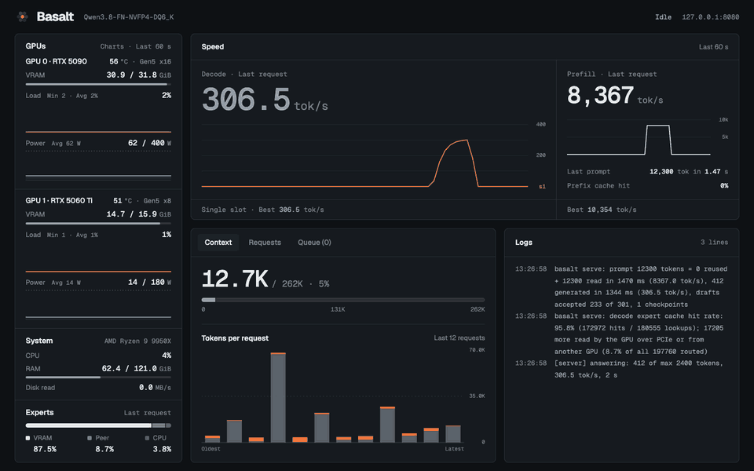

# Adamant

Adamant is an Ada Lovelace (RTX 40-series, sm_89) fork of
[Basalt](https://github.com/jesdga95/basalt), the local inference engine for the
**Qwen3.8-Flash-Next** mixture-of-experts model, itself based on Strata.

> **Status: early development.** The Ada port builds and passes its Linux test
> suite on an RTX 4090, but numerical quality and headline performance are still
> open gates — see [Ada execution and validation](docs/precision/ada.md). The
> performance numbers below are development runs on one card, not the
> maintainer's headline numbers. Expect breakage; flags, defaults and the pack
> layout can still change. Linux and Windows platform support is retained as a
> port requirement.

Experts that do not fit in VRAM live in system RAM, and optionally on a second GPU used as a peer expert tier.
A large MoE model runs on one workstation, behind an OpenAI- and Anthropic-compatible API.

**Help wanted:** have some spare compute to lend for testing? See [Contributing](CONTRIBUTING.md#other-ways-to-help).

<p align="center"></p>

## Requirements

- Linux x86-64 with AVX2 (AVX-512 is used when present), and an NVIDIA Ada Lovelace GPU (compute capability 8.9) with CUDA 13.
- CMake 3.24 or newer, GCC 13 or newer, and Python 3.10 or newer.
- Enough system RAM to hold the experts that do not fit in VRAM.

## Quick start

```sh
git clone <adamant remote> && cd adamant
cmake -S . -B build -DCMAKE_BUILD_TYPE=Release
cmake --build build -j                  # bin/basalt, bin/basalt-bench, bin/basalt-probe, bin/basalt-vision
pip install -r requirements.txt
hf download jesdga/Qwen3.8-Flash-Next-Basalt Qwen3.8-FN-GSQ-RCO-IQ3_S.basalt --local-dir models
```

The build targets sm_89 only; `-DCMAKE_CUDA_ARCHITECTURES` with anything else is
refused. The toolchain and test invocations used for the results below are in
[Ada execution and validation](docs/precision/ada.md).

The binary and file-format names stay `basalt` and `.basalt`: the packs are the
same files Basalt reads, so a fork that renamed them would break every existing
model. Adamant is the project name, not a new format.

Put your settings in `basalt_config.json`, with `model` pointing at the downloaded file:

```json
{
  "server": { "model": "models/Qwen3.8-FN-GSQ-RCO-IQ3_S.basalt", "gpu": "0,1", "port": 8080 },
  "engine": { "expert-cache": "auto", "prefill": "auto", "kv": "int8", "resident-experts": true }
}
```

```sh
bin/basalt serve --config basalt_config.json
```

The server listens on 127.0.0.1 by default.

## Measured on Ada

Development measurements, not the maintainer's headline runs: one RTX 4090 at a
**450 W** power limit, the GSQ-RCO IQ3_S pack converted with `tools/convert`,
int8 KV, expert cache auto — all experts held in 17.4 GiB of VRAM and 29.4 GiB of
page-locked RAM, none read from the SSD.

A measured Adamant-versus-Strata development comparison across three fixtures
and two prompt lengths is documented in [the comparison report](docs/benchmarks/strata-comparison.md).

`basalt-bench` fixtures, MTP drafter off → on: conv 115 → 190, struct 116 → 372,
prose 116 → 169 tok/s (draft acceptance 69%, 94%, 60%). The spread is drafting
acceptance per content, not engine speed. No accuracy-reducing option is enabled
(`--route-tail-skip`, `--route-prior`, `--relaxed-drafting` are off).

## Models

<p align="center"></p>

Ready-to-run packs, with the quality of each measured against full precision (a BF16 reference), are on
[Hugging Face](https://huggingface.co/jesdga/Qwen3.8-Flash-Next-Basalt):
`Qwen3.8-FN-NVFP4-DQ6_K`, `-NVFP4-DQ8`, `-UD-Q4_K_XL`, `-UD-Q5_K_XL`, `-UD-Q6_K_XL`, `-Q8_0`, `-GSQ-RCO-IQ3_S`, `-GSQ-RCO-IQ3_XXS` and `-GSQ-RCO-Q2_0` (each `.basalt`).
The two NVFP4 packs share NVIDIA's NVFP4 experts; `D` names the dense projections' format: DQ6_K is the default and
faster, DQ8 is about 7% slower on prose with a lower KLD ([precision](docs/precision/isolated-costs.md)).
A model is one file: weights, tokenizer, MTP drafter, 8-bit hyper-connection copies and vision projector. The expert
profile ships with the engine ([data/profiles](data/profiles)).

On Ada the NVFP4 packs run through the integer MMQ path rather than native FP4
tensor instructions, so their numerics differ from a Blackwell run; the IQ3_S,
Q4_K and Q5_K formats use the same kernels. `Qwen3.8-FN-GSQ-RCO-IQ3_S` is the
quant the measurements above used, and the recommended starting point on a
24 GB card. A pack can be built locally from a GGUF, drafter included
([model file](docs/model-file.md), [precision on Ada](docs/precision/ada.md)).

## Docs

- [Configuration](docs/configuration/index.md): every setting.
- [Running](docs/running.md): parallel requests, prompt chunks, memory floors, image input.
- [basalt-probe](docs/probe.md): measures the machine, the cold decode speed, and suggests values.
- [The .basalt model file](docs/model-file.md): the layout, and building a pack yourself (including NVFP4).
- [Platforms](docs/platforms.md): Linux and Windows requirements, the build steps and the Windows limitations.
- [Changelog](docs/changelog/index.md): what each release changed.
- [Building and testing](docs/building.md), [Precision and quality](docs/precision/index.md), [Contributing](CONTRIBUTING.md).

## Credits

- [Basalt](https://github.com/jesdga95/basalt): the project Adamant forks (MIT).
- [Strata](https://github.com/Niko1221/Strata): the project Basalt forks (MIT).
- [Qwen](https://huggingface.co/Qwen/Qwen3.8-Flash-Next): the model. The packs are under the [Qwen Community License 1.0](https://huggingface.co/Qwen/Qwen3.8-Flash-Next/blob/main/LICENSE), not Basalt's MIT license.
- [unsloth](https://huggingface.co/unsloth): the UD and Q8_0 GGUFs the packs are built from.
- IST Austria DAS Lab: the GSQ-RCO quants; please cite [GSQ](https://arxiv.org/abs/2604.18556) and [RCO](https://arxiv.org/abs/2605.00649).
- [NVIDIA](https://huggingface.co/nvidia/Qwen3.8-Flash-Next-NVFP4): the NVFP4 experts.
- [ggml and llama.cpp](https://github.com/ggml-org/llama.cpp): quantization formats and kernels extracted into `src/` (MIT, see [THIRD_PARTY_LICENSES](THIRD_PARTY_LICENSES)).

## License

MIT, see [LICENSE](LICENSE).
