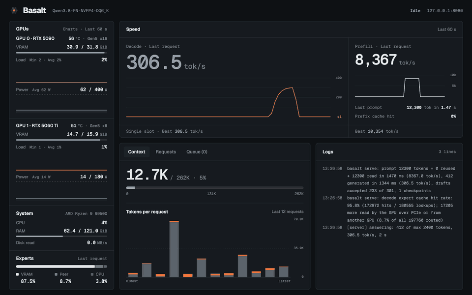

# Adamant

[English](README.md)

Adamant 是 [Basalt](https://github.com/jesdga95/basalt) 的 Ada Lovelace（RTX 40 系列，sm_89）分支；Basalt 是 **Qwen3.8-Flash-Next** 混合专家模型的本地推理引擎，其本身基于 Strata。

> **状态：早期开发阶段。** Ada 移植可以构建，并在一块 RTX 4090 上通过其 Linux 测试套件，但数值质量和整体性能仍是未关闭的关口——见 [Ada 平台的执行与验证](docs/zh/precision/ada.md)。下面的性能数字是在一块卡上的开发性测试，不是维护者的官方基准数字。可能出现故障；标志、默认值和 pack 布局仍可能变化。保留 Linux 和 Windows 平台支持是一项移植要求。

放不进 VRAM 的专家驻留在系统 RAM 中，并且可以可选地使用第二块 GPU 作为对等专家层。
一台工作站就能运行大型 MoE 模型，对外提供 OpenAI 和 Anthropic 兼容的 API。

**需要帮助：** 有多余算力可以借出来做测试？见[贡献指南](CONTRIBUTING.zh-CN.md#其他贡献方式)。

<p align="center"></p>

## 环境要求

- 支持 AVX2 的 Linux x86-64（存在 AVX-512 时会使用它），或 Windows 10 1903+ x64（[平台](docs/zh/platforms.md)）。
- 一块带 CUDA 13 的 NVIDIA Ada Lovelace GPU（compute capability 8.9）。
- CMake 3.24 或更新版本、GCC 13 或更新版本（Linux）、Python 3.10 或更新版本。
- 足够的系统 RAM，用来存放放不进 VRAM 的专家。

## 快速开始

```sh
git clone <adamant remote> && cd adamant
cmake -S . -B build -DCMAKE_BUILD_TYPE=Release
cmake --build build -j                  # bin/basalt, bin/basalt-bench, bin/basalt-probe, bin/basalt-vision
pip install -r requirements.txt
hf download jesdga/Qwen3.8-Flash-Next-Basalt Qwen3.8-FN-GSQ-RCO-IQ3_S.basalt --local-dir models
```

构建只面向 sm_89；`-DCMAKE_CUDA_ARCHITECTURES` 指定其他架构会被拒绝。下面结果所使用的工具链和测试调用方式记录在 [Ada 平台的执行与验证](docs/zh/precision/ada.md) 中。

二进制和文件格式的名称保持为 `basalt` 和 `.basalt`：这些 pack 仍然是 Basalt 读取的同一批文件，一个改名的分支会破坏所有现有模型。Adamant 是项目名，不是新格式。

把你的设置写进 `basalt_config.json`：`models` 列表列出多个 pack，每一项自己的 `gpu` 和 `kv` 优先于顶层的 `engine` 块（[模型与路由](docs/zh/configuration/models.md)）：

```json
{
  "version": 2,
  "models": [{ "model": "models/Qwen3.8-FN-GSQ-RCO-IQ3_S.basalt", "gpu": "0,1", "kv": "int8" }],
  "engine": { "expert-cache": "auto", "prefill": "auto", "resident-experts": true },
  "server": { "port": 8080 }
}
```

```sh
bin/basalt serve --config basalt_config.json
```

服务器默认监听 127.0.0.1。

## Ada 上的实测

开发性测试，不是维护者的官方基准：一块功耗限制设为 **450 W** 的 RTX 4090，用 `tools/convert` 转换的 GSQ-RCO IQ3_S pack，int8 KV，expert cache auto——全部专家驻留在 17.4 GiB VRAM 和 29.4 GiB 页锁定 RAM 中，均不读自 SSD。

一项跨三个 fixture、两种提示词长度的 Adamant 对 Strata 实测开发对比记录在[对比报告](docs/zh/benchmarks/strata-comparison.md)中。

`basalt-bench` fixtures，MTP drafter 关 → 开：conv 115 → 190、struct 116 → 372、prose 116 → 169 tok/s（draft 接受率 69%、94%、60%）。这一差距来自不同内容的 drafting 接受率，而不是引擎速度。没有启用任何降低精度的选项（`--route-tail-skip`、`--route-prior`、`--relaxed-drafting` 均为关闭）。

## 模型

<p align="center"></p>

开箱即用的 pack，每一款的质量都对照全精度（BF16 参考）测量过，发布在
[Hugging Face](https://huggingface.co/jesdga/Qwen3.8-Flash-Next-Basalt) 上：
`Qwen3.8-FN-NVFP4-DQ6_K`、`-NVFP4-DQ8`、`-UD-IQ1_S`、`-UD-IQ1_M`、`-UD-IQ2_XS`、`-UD-IQ3_XXS`、`-UD-IQ4_XS`、`-UD-Q4_K_XL`、`-UD-Q5_K_XL`、`-UD-Q6_K_XL` 和 `-Q8_0`（每个都是 `.basalt`）。
两个 NVFP4 pack 共用 NVIDIA 的 NVFP4 专家；`D` 表示 dense 投影的格式：DQ6_K 是默认值且更快，DQ8 在 prose 上约慢 7%，KLD 更低（[精度](docs/zh/precision/qwen38-flash-next.md)）。
一个模型就是一个文件：权重、分词器、MTP drafter、8-bit hyper-connection 副本和 vision projector。专家 profile 随引擎一起发布（[data/profiles](data/profiles)）。

在 Ada 上，NVFP4 pack 经由整数 MMQ 路径运行，而不是原生 FP4 张量指令，因此其数值与 Blackwell 上的运行不同；IQ3_S、Q4_K 和 Q5_K 格式使用相同的 kernel。`Qwen3.8-FN-GSQ-RCO-IQ3_S` 是上述测量所用的量化，也是 24 GB 显卡的推荐起点。可以从 GGUF 在本地构建 pack，包括 drafter（[模型文件](docs/zh/model-file.md)、[Ada 上的精度](docs/zh/precision/ada.md)）。

## 文档

- **运行：**[运行](docs/zh/running.md)、[配置](docs/zh/configuration/index.md)、[模型与路由](docs/zh/configuration/models.md)、
  [采样](docs/zh/configuration/sampling.md)、[图像来源](docs/zh/configuration/image-sources.md)、
  [诊断](docs/zh/configuration/diagnostics.md)、[basalt-probe](docs/zh/probe.md)、[平台](docs/zh/platforms.md)。
- **模型：**[模型](docs/zh/models/index.md)、[Flash-Next](docs/zh/models/qwen38-flash-next.md)、
  [`.basalt` 文件](docs/zh/model-file.md)、[文件格式变更](docs/zh/basalt-file-changelog.md)。
- **质量：**[精度](docs/zh/precision/index.md)、[方法](docs/zh/precision/quality.md)。
- **构建与开发：**[构建与测试](docs/zh/building.md)、[新增模型](docs/zh/adding-a-model.md)、[社区实测](docs/zh/community.md)、
  [更新日志](docs/zh/changelog/index.md)、[贡献指南](CONTRIBUTING.zh-CN.md)。

## 致谢

- [Basalt](https://github.com/jesdga95/basalt)：Adamant 从中 fork 出来的项目（MIT）。
- [Strata](https://github.com/Niko1221/Strata)：Basalt 从中 fork 出来的项目（MIT）。
- [Qwen](https://huggingface.co/Qwen/Qwen3.8-Flash-Next)：模型本身。pack 依据 [Qwen Community License 1.0](https://huggingface.co/Qwen/Qwen3.8-Flash-Next/blob/main/LICENSE) 发布，而非 Basalt 的 MIT 许可证。
- [unsloth](https://huggingface.co/unsloth)：pack 构建所基于的 UD 和 Q8_0 GGUF。
- IST Austria DAS Lab：GSQ-RCO 量化；请引用 [GSQ](https://arxiv.org/abs/2604.18556) 和 [RCO](https://arxiv.org/abs/2605.00649)。
- [NVIDIA](https://huggingface.co/nvidia/Qwen3.8-Flash-Next-NVFP4)：NVFP4 专家。
- [ggml 和 llama.cpp](https://github.com/ggml-org/llama.cpp)：被提取到 `src/` 中的量化格式与 kernel（MIT，见 [THIRD_PARTY_LICENSES](THIRD_PARTY_LICENSES)）。

## 许可证

MIT，见 [LICENSE](LICENSE)。
